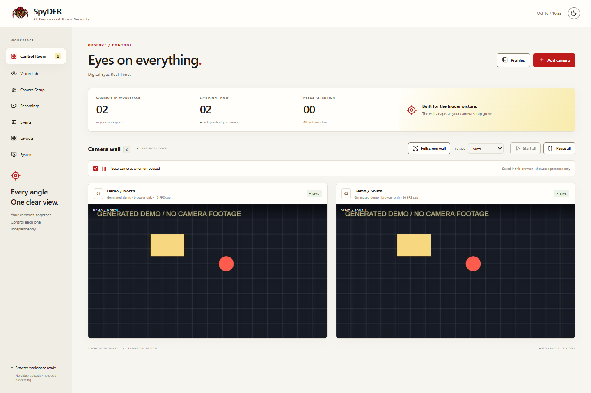
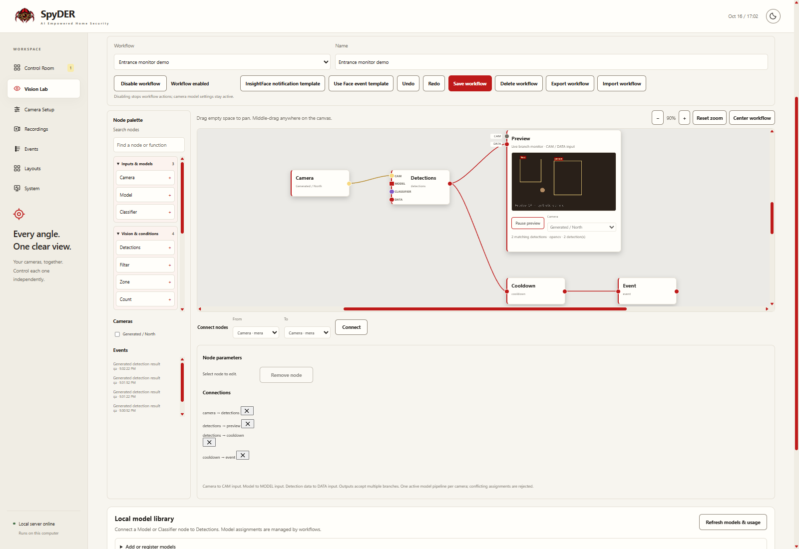
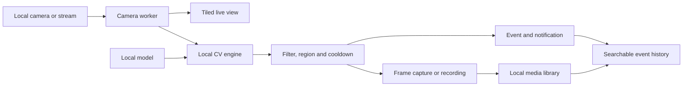

# SpyDER

> AI Empowered Home Security — a local camera control room with computer vision, visual workflows and event-linked recordings.

  

<p align="center">
  
</p>

## The idea

Watching several cameras becomes more useful when a detection can lead to an action:
filter a class, check a region, capture a frame, save a clip or notify the person monitoring
the feeds. Those steps should share the same cameras instead of opening competing captures
or sending footage to a cloud inference service.

SpyDER brings that loop into one installable Python application. The browser is the control
surface; camera capture, native CV, workflow execution and storage run on the user's computer.
A separate static showcase demonstrates browser-supported features without a cloud camera backend.

## Showcase



*Control Room in the static browser showcase. These are generated test patterns,
not surveillance footage or evidence of model accuracy.*

| Workspace | What the current prototype demonstrates |
| --- | --- |
| Control Room | Concurrent feeds, responsive tiling, a fullscreen wall, camera controls, themes and recording/capture actions. |
| Vision Lab | MOG2 motion analysis, contours, connected components, tracking and ROI selection; draft previews before applying settings. |
| Visual workflows | Camera/model inputs, detection/classification, multi-connection branches, filters, zones, counts, cooldowns, restricted Python/JavaScript transformations and action nodes. |
| Model library | Local upload/registration, class metadata inspection, search/filtering, reusable model nodes and reference checks before removal. |
| Events | Persistent motion/workflow records, naming patterns, image/clip attachments, inline viewing, search, grouping, pagination, rename and bulk ZIP export/deletion. |
| Recordings | One tiled video that adapts as camera membership changes, frame captures and a persistent media catalog. |
| Setup and System | Supported device controls, reusable tuning profiles, focus policy, dependency diagnostics and configurable media output. |



*Vision Lab with a synthetic camera and demonstration detection results. Actual inference
requires compatible local models and runtime dependencies.*

## A representative flow



A face-detection branch can use a lightweight SCRFD detector, an optional classifier,
an identity/class filter and a cooldown before creating a named event with a capture.
The workflow is explicitly enabled; editing a graph does not silently activate it.

## How it is built

| Layer | Implementation |
| --- | --- |
| Local application | Python 3.11+, a standard-library loopback HTTP server and an installed CLI. |
| Browser UI | Vanilla JavaScript, CSS, SVG and Canvas; no frontend build or Node server required. |
| Camera processing | Per-camera workers and bounded latest-frame buffers avoid an unbounded inference backlog. |
| Computer vision | OpenCV and NumPy, with optional Ultralytics YOLO and InsightFace/ONNX Runtime adapters. |
| Workflows | Validated graphs over fresh results, explicit camera/model inputs and live data bindings. |
| Persistence | Local JSON catalogs, atomic updates, stable data paths and recorder-owned media references. |
| Static showcase | Exported assets, browser camera/file APIs and browser recording; suitable for Cloudflare Pages. |

The camera worker owns capture. Live views, previews and recording reuse its results.
Preview invalidation follows the upstream branch: moving a node, renaming a workflow or
editing an unrelated branch does not restart that preview.

## Run locally

### Development environment

Requires Python 3.11+. Reuse one `.venv` and stop existing SpyDER instances before installing.

```powershell
if (-not (Test-Path .\.venv\Scripts\python.exe)) {
    python -m venv .venv
}
.\.venv\Scripts\python.exe -m pip install "setuptools>=77,<81" wheel
.\.venv\Scripts\python.exe -m pip install --no-build-isolation -e ".[dev]"
.\.venv\Scripts\python.exe -m spyder_cctv gui
```

Open the displayed address, normally `http://127.0.0.1:8765`, and add a camera. Ctrl+C in
the launching terminal stops the server; closing the browser alone does not. Editable asset
changes need a browser refresh; Python changes need a restart. On Linux/macOS use
`.venv/bin/python` and the equivalent shell commands.

To test without changing everyday camera settings or media:

```powershell
.\.venv\Scripts\python.exe -m spyder_cctv --config .\.pytest_cache\demo\config.json gui
```

First GUI launch creates an empty configuration. Optional adapters need their declared
extras and compatible local models; weights are not included. Use
`python -m spyder_cctv vision-info` with the environment's Python to inspect dependencies.

### Browser showcase

The showcase is prepared for static hosting but is **not presented here as a deployed live
service**. Export a fresh directory and preview it locally:

```powershell
.\.venv\Scripts\python.exe -m spyder_cctv export-showcase --output .\dist\showcase-preview
.\.venv\Scripts\python.exe -m http.server 8787 --bind 127.0.0.1 --directory .\dist\showcase-preview
```

Open `http://127.0.0.1:8787`. The exporter refuses to overwrite existing output. Python's
preview server does not apply Cloudflare's `_headers` file; verify deployment headers separately.

| Capability | Installed Python app | Static browser showcase |
| --- | --- | --- |
| Capture | OpenCV-supported devices, streams and files | Generated feeds, permitted webcams and selected local video |
| CV | Native OpenCV and optional model runtimes | Browser motion demonstration; no native YOLO/InsightFace execution |
| Workflows/events | Native execution, persistent history and attachments | Native execution controls are unavailable |
| Recording | Persistent local tiled recordings and captures | Browser recording; download media before closing the tab |
| Hosting | User's computer, bound to loopback | Static assets; camera/video processing stays in the visitor's browser |

## Engineering decisions

- **Bound the work.** Latest-frame scheduling favors fresh results over a growing queue.
- **Separate preview from activation.** Simulated tuning, draft motion settings and workflow
  previews let the user inspect changes before altering the active pipeline.
- **Separate identity stability from accuracy.** Confidence margins and consecutive confirmations
  reduce flicker; a closed-set classifier still cannot guarantee unknown-person rejection.
- **Make actions traceable.** Events link to recorder-owned media. Timed clips avoid stopping
  sessions transferred to manual control or another workflow.
- **Design for installation.** Package resources and stable data paths avoid checkout-relative
  assumptions. Changing output folders retains access to earlier media.
- **Keep the demo honest.** Static hosting serves the interface rather than remote Python
  inference. The portfolio's Live control remains disabled until deployment is ready.

## Validation

Tests use injected camera/model fixtures, temporary storage and JavaScript runtime checks.
Hardware and real-model validation are separate from synthetic regression evidence.

```powershell
.\.venv\Scripts\python.exe -m ruff check src tests
.\.venv\Scripts\python.exe -m ruff format --check src tests
.\.venv\Scripts\python.exe -m pytest -q
node --test
.\.venv\Scripts\python.exe -m build --no-isolation
```

Node.js 22+ is a test tool, not the application server. Check installed wheels outside the
checkout too, to catch missing assets and source-path assumptions. See [Contributing](CONTRIBUTING.md).

## Current scope and limits

SpyDER is an active prototype for local, single-user operation, not a hardened internet-facing
surveillance service or a guarantee of security or identification accuracy.

- Native controls depend on the camera and driver; Windows USB/built-in cameras have the
  current native-control implementation. Stream support depends on OpenCV codecs.
- Model input/output formats and preprocessing must match the adapter. Reading class metadata
  does not prove inference compatibility or model quality.
- CV concurrency depends on hardware and workload. Capacity estimates are guidance, not
  guaranteed camera counts or frame rates.
- Composite video currently uses a 1920 × 1080 canvas at 15 fps without audio. Unsupported
  browser codecs can use a local preview at up to 5 fps; downloads retain the original video.
- The event catalog retains the latest 10,000 records. Event deletion retains its media.
- Layouts currently offers tile-size choices. Named presets, manual arrangements and rotation
  remain future work.
- Screenshots use generated inputs. Real cameras, models and environments need separate testing.

## Public documentation and portfolio

[Public documentation](doc-public/README.md) contains publishable material and presentation
assets. The root [portfolio-showcase.json](portfolio-showcase.json) follows the companion
portfolio's showcase contract. Local `docs/` notes are ignored and excluded from source
distributions. No distribution license has been selected yet.
