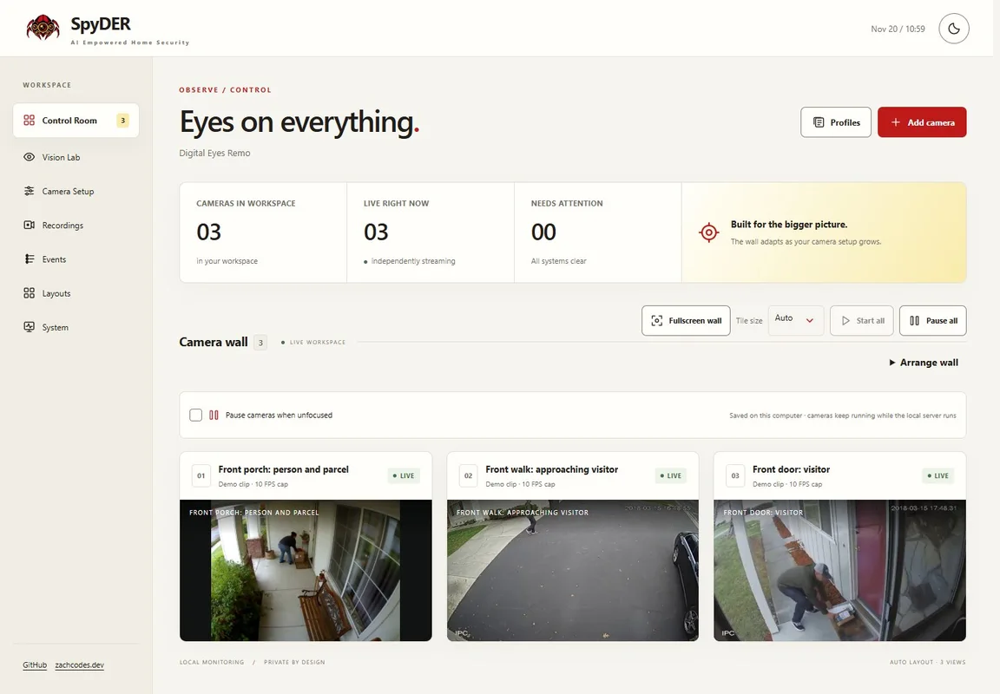
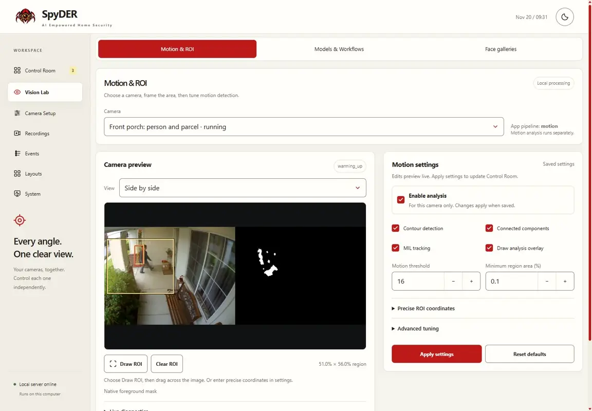
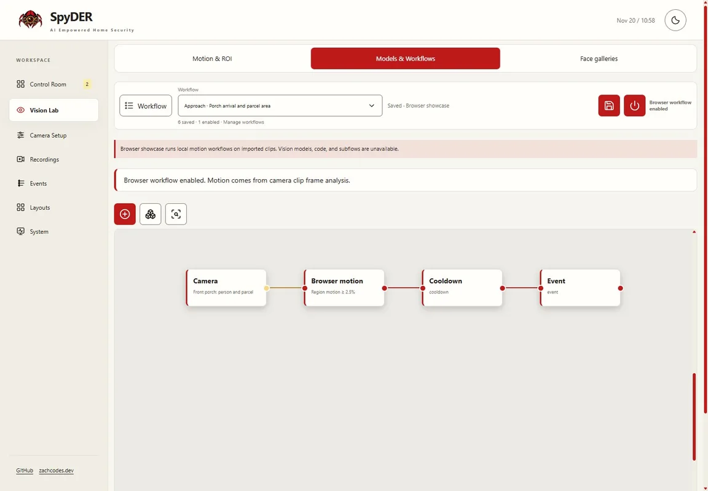
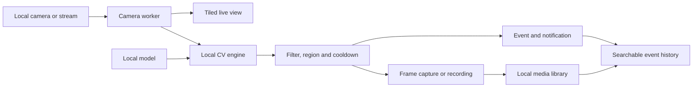

# SpyDER

> AI Empowered Home Security — a local camera control room with computer vision, visual workflows and event-linked recordings.

  

<p align="center">
  
</p>

[Try the browser demo](https://spyder.zachcodes.dev) | [Run locally](#run-locally) | [Documentation](doc-public/README.md)

## The idea

Watching several cameras becomes more useful when a detection can lead to an action:
filter a class, check a region, capture a frame, save a clip or notify the person monitoring
the feeds. Those steps should share the same cameras instead of opening competing captures
or sending footage to a cloud inference service.

SpyDER brings that loop into one installable Python application. The browser is the control
surface; camera capture, native CV, workflow execution and storage run on the user's computer.
A separate static showcase demonstrates browser-supported features without a cloud camera backend.

## Showcase



*Recorded from SpyDER: three demo camera feeds with live OpenCV motion regions and a temporary MIL track. [Watch the MP4](doc-public/assets/control-room.mp4).*

| Workspace | What the current prototype demonstrates |
| --- | --- |
| Control Room | Concurrent feeds, responsive tiling, a fullscreen wall, camera controls, themes and recording/capture actions. |
| Vision Lab | MOG2 motion analysis, contours, connected components, tracking and ROI selection; draft previews before applying settings. |
| Visual workflows | Camera/model inputs, detection/classification, multi-connection branches, filters, zones, counts, cooldowns, restricted Python/JavaScript transformations and action nodes. |
| Model library | Local upload/registration, class metadata inspection, search/filtering, reusable model nodes and reference checks before removal. |
| Events | Persistent motion/workflow records, naming patterns, image/clip attachments, inline viewing, search, grouping, pagination, rename and bulk ZIP export/deletion. |
| Recordings | One tiled video that adapts as camera membership changes, frame captures, a persistent media catalog and clock-based timeline playback. |
| Layouts | Saved walls, fixed camera pins, activity priority, drag/keyboard ordering, visibility, featured/rotating views, import/export and browser-only dummy cameras for simulation. |
| Setup and System | Supported device controls, reusable tuning profiles, focus policy, dependency diagnostics and configurable media output. |



*Vision Lab in the installed Python app: side-by-side source and MOG2 mask, ROI, contours and tracking. [Watch the MP4](doc-public/assets/vision-lab.mp4).*



*An existing bundled workflow: Camera → Browser motion → Cooldown → Event, enabled in the static demo. [Watch the MP4](doc-public/assets/workflows.mp4).*

These are recordings of the working application using licensed sample footage. Motion regions
and track IDs demonstrate analysis behavior, not verified person identities or model accuracy.
[Footage credits and presentation media](doc-public/assets/README.md).

## A representative flow



A face-detection branch can use a lightweight SCRFD detector, an optional classifier,
an identity/class filter and a cooldown before creating a named event with a capture.
The workflow is explicitly enabled; editing a graph does not silently activate it.

## How it is built

| Layer | Implementation |
| --- | --- |
| Local application | Python 3.11+, a standard-library loopback HTTP server and an installed CLI. |
| Browser UI | Vanilla JavaScript, CSS, SVG and Canvas; no frontend build or Node server required. |
| Camera processing | Per-camera workers and bounded latest-frame buffers avoid an unbounded inference backlog. |
| Computer vision | OpenCV and NumPy, with optional Ultralytics YOLO and InsightFace/ONNX Runtime adapters. |
| Workflows | Validated graphs over fresh results, explicit camera/model inputs and live data bindings. |
| Persistence | Local JSON catalogs, atomic updates, stable data paths and recorder-owned media references. |
| Static showcase | Exported assets, browser camera/file APIs and browser recording; suitable for Cloudflare Pages. |

The camera worker owns capture. Live views, previews and recording reuse its results.
Preview invalidation follows the upstream branch: moving a node, renaming a workflow or
editing an unrelated branch does not restart that preview.

## Run locally

### Development environment

Requires Python 3.11+. Reuse one `.venv` and stop existing SpyDER instances before installing.

```powershell
if (-not (Test-Path .\.venv\Scripts\python.exe)) {
    python -m venv .venv
}
.\.venv\Scripts\python.exe -m pip install "setuptools>=77,<81" wheel
.\.venv\Scripts\python.exe -m pip install --no-build-isolation -e ".[dev]"
.\.venv\Scripts\python.exe -m spyder_cctv gui
```

Open the displayed address, normally `http://127.0.0.1:8765`, and add a camera. Ctrl+C in
the launching terminal stops the server; closing the browser alone does not. Editable asset
changes need a browser refresh; Python changes need a restart. On Linux/macOS use
`.venv/bin/python` and the equivalent shell commands.

To test without changing everyday camera settings or media:

```powershell
.\.venv\Scripts\python.exe -m spyder_cctv --config .\.pytest_cache\demo\config.json gui
```

First GUI launch creates an empty configuration. Optional adapters need their declared
extras and compatible local models; weights are not included. Use
`python -m spyder_cctv vision-info` with the environment's Python to inspect dependencies.

### Browser showcase

Try **Front porch: person and parcel** in the [live demo](https://spyder.zachcodes.dev). Start the feed in Control Room, watch for motion inside the porch approach area, then open **Events** to review what triggered. Use **Add camera → Home security demo clip** to explore the other scenes. All eight clips loop on the visitor's device.

To preview the same static export locally:

```powershell
.\.venv\Scripts\python.exe -m spyder_cctv export-showcase --output .\dist\showcase-preview
.\.venv\Scripts\python.exe -m http.server 8787 --bind 127.0.0.1 --directory .\dist\showcase-preview
```

Open `http://127.0.0.1:8787`. The exporter refuses to overwrite existing output. Python's
preview server does not apply Cloudflare's `_headers` file; verify deployment headers separately.

| Capability | Installed Python app | Static browser showcase |
| --- | --- | --- |
| Capture | OpenCV-supported devices, streams and files | Bundled home-security clips, generated feeds, permitted webcams and selected local video |
| CV | Native OpenCV and optional model runtimes | OpenCV.js MOG2 and one automatic porch MIL tracker with load-based fallback; frame difference on other feeds by default |
| Workflows/events | Reusable subflows, configurable execution history and event attachments | Camera, browser motion, cooldown and action nodes run in the tab; event metadata persists in the browser |
| Recording | Local H.264 MP4 clips, storage profiles, schedules and captures | Browser recording; download media before closing the tab |
| Hosting | User's computer, bound to loopback | Static assets; camera/video processing stays in the visitor's browser |

In the installed app, review a clip on the [recording timeline](doc-public/user-guide/timeline-playback.md), toggle its [saved detection overlays](doc-public/user-guide/recording-detection-replay.md), or open it for [face enrollment](doc-public/user-guide/face-galleries-and-onvif.md). The System workspace provides [backup and restore](doc-public/user-guide/backups.md), with footage included on request. See the [public documentation](doc-public/README.md) for setup and limitations.

## Engineering decisions

- **Bound the work.** Latest-frame scheduling favors fresh results over a growing queue.
- **Separate preview from activation.** Simulated tuning, draft motion settings and workflow
  previews let the user inspect changes before altering the active pipeline.
- **Separate identity stability from accuracy.** Confidence margins and consecutive confirmations
  reduce flicker; a closed-set classifier still cannot guarantee unknown-person rejection.
- **Make actions traceable.** Events link to recorder-owned media. Timed clips avoid stopping
  sessions transferred to manual control or another workflow.
- **Design for installation.** Package resources and stable data paths avoid checkout-relative
  assumptions. Changing output folders retains access to earlier media.
- **Keep the demo honest.** Cloudflare serves static files. Each visitor’s browser decodes the demo clips, analyzes motion and records locally.

## Validation

Tests use injected camera/model fixtures, temporary storage and JavaScript runtime checks.
Hardware and real-model validation are separate from synthetic regression evidence.

```powershell
.\.venv\Scripts\python.exe -m ruff check src scripts/tests
.\.venv\Scripts\python.exe -m ruff format --check src scripts/tests
.\.venv\Scripts\python.exe -m pytest -q
node --test
.\.venv\Scripts\python.exe -m build --no-isolation
```

Node.js 22+ is a test tool, not the application server. Check installed wheels outside the
checkout too, to catch missing assets and source-path assumptions. See [Contributing](CONTRIBUTING.md).

## Current scope and limits

SpyDER is an active prototype for local, single-user operation, not a hardened internet-facing
surveillance service or a guarantee of security or identification accuracy.

- Native controls depend on the camera and driver; Windows USB/built-in cameras have the
  current native-control implementation. Stream support depends on OpenCV codecs.
- Model input/output formats and preprocessing must match the adapter. Reading class metadata
  does not prove inference compatibility or model quality.
- CV concurrency depends on hardware and workload. Capacity estimates are guidance, not
  guaranteed camera counts or frame rates.
- Composite video offers Archive (360p/3 fps), Efficient (720p/8 fps, default) and Detail
  (1080p/15 fps) storage profiles without audio. Native recordings use H.264 MP4 clips.
  Unsupported browser codecs can use a local preview at up to 5 fps; downloads retain the original video.
- The event catalog retains the latest 10,000 records. Event deletion retains its media.
- Layouts persist per browser and origin. Export arrangements for backup or transfer. Missing
  camera IDs remain unavailable until the original cameras return. Dummy cameras are simulations
  and stay outside CV, capture and recording.
- The showcase recordings use licensed residential-camera footage. Hardware performance and recognition accuracy depend on the device, model and scene.

## Public documentation and portfolio

[Documentation](doc-public/README.md) includes [getting started](doc-public/getting-started.md),
[Vision Lab and workflows](doc-public/user-guide/vision-workflows.md), the
[development guide](doc-public/development/guide.md), and [Cloudflare hosting](doc-public/deployment/cloudflare.md).
[Presentation assets](doc-public/portfolio.md) document the portfolio screenshots and emblem.
The root [portfolio-showcase.json](portfolio-showcase.json) follows the companion
portfolio's showcase contract. Local `docs/` notes are ignored and excluded from source
distributions. No distribution license has been selected yet.

Recording storage profiles, daily size estimates and continuous clip behavior are documented in
[Recording storage](doc-public/recording-storage.md). The Archive preset targets about 0.69 GB/day
for the entire mosaic at reduced detail; actual size varies.
