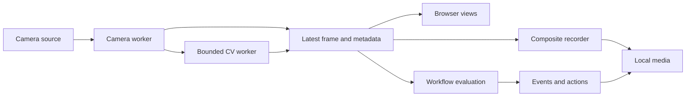

# Architecture

[Documentation home](../README.md)

## Overview

SpyDER is an installable Python package with a loopback HTTP adapter and bundled
browser UI. The source tree is not a runtime data directory. The static showcase
reuses interface assets but substitutes a separate browser-owned runtime.

## Module responsibilities

| Area | Main modules |
| --- | --- |
| Composition and validated configuration | `cli.py`, `config.py` |
| Capture ownership and camera lifecycle | `cameras.py`, `capture.py` |
| Hardware controls and profiles | `controls.py`, `directshow.py` |
| HTTP adapter and packaged UI | `web.py`, `assets/` |
| Native engines and bounded inference | `cv/contracts.py`, `cv/engines.py`, `cv/runtime.py` |
| Draft analysis and motion | `analysis_preview.py`, `analysis_runtime.py`, `motion.py`, `motion_config.py` |
| Models and metadata | `model_library.py`, `model_metadata.py`, `cv/detectors.py` |
| Workflow validation and execution | `workflow.py`, `workflow_code.py`, `assets/workflow-editor.js` |
| Media and crash recovery | `recording.py`, `video_encoder.py`, `recording_recovery.py` |
| Quota policy and data locations | `recording_allowance.py`, `storage.py` |
| Durable events and preferences | `events.py`, `preferences.py` |
| Static export and browser runtime | `showcase.py`, `assets/showcase.js`, `assets/browser-recording.js` |

## Ownership and scheduling

A camera worker owns its capture handle and device operations. Live views, preview
analysis, and the recorder reuse frames instead of opening competing captures.
Workers expose bounded latest-frame/result snapshots; slow consumers do not accumulate
an unbounded frame queue. Model/analysis workers use replaceable pending work and
lower effective update frequency under load.

A pipeline failure should report an error for its camera rather than corrupt other
workers. Native reads/inference can still block: Python threads cannot safely terminate
arbitrary native calls. Shutdown deadlines and duplicate-start guards limit the impact,
but full recovery from a permanently blocked library needs stronger process isolation.

The recorder owns one composite session, samples existing camera workers, and writes
fragmented H.264 MP4 through a local FFmpeg subprocess. Its frame size/rate comes from
the selected storage profile. Camera membership changes rearrange tiles inside that
fixed canvas. See [recovery and storage](../recording-storage.md) for persistence guarantees.

## Drafts, activation, and persistence

Draft tuning and analysis previews are separate from active camera settings.
Workflow previews follow their upstream dependency branch so cosmetic edits do not
unnecessarily refresh camera frames. Saved graph layout is not equivalent to enabled
workflow execution. Activation validates compatible bindings and reviews camera changes.

Configuration, graphs, catalogs, and model descriptors use validated local persistence
and atomic replacement. Media IDs resolve through catalogs rather than arbitrary HTTP
file paths. Active recording journals and an OS lease allow conservative recovery
without modifying a live encoder's file. This does not make the entire media library
a multi-user database. See [data ownership](../reference/data-and-privacy.md).

## Extension points and boundaries

Inject capture, pipeline, and encoder dependencies through `CameraManager` for adapters
and deterministic tests. Engine contracts normalize detections into the application's
box/metadata representation; a new model format needs explicit preprocessing/output
adaptation. Keep device and transport operations outside CV algorithms.

Read installed UI assets with `importlib.resources`; write user data outside the
package. Camera imports should not open hardware or start downloads. Optional detector
installation remains explicit. The HTTP server is a local adapter with loopback guards,
not an authenticated public surveillance service.

The Cloudflare export contains only static interface assets. Native execution stays
unavailable rather than falling back to cloud inference or silently contacting a local
server. Its CSP and browser-local adapter enforce that separate deployment boundary.
